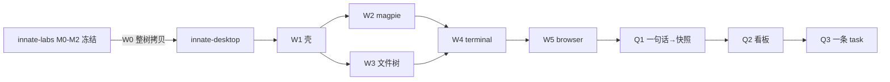

# plan1（已归档）

> **2026-10-28 起本计划已合并入 docs/susu/plan2/ 并停止维护。**
> 合并采纳了本目录 reviews/2026-10-28-plan-review.md 的全部修改（W1 拆 a/b/c、视觉规范指向 susu-overview STYLEGUIDE 副本、组件来源三分法、字体决策门）。
> 以下正文写作于 susu-web 删除前，部分事实（双轨 dev、改名坏点清单）已过时，仅作历史参考。

<!-- ARCHIVED-BANNER -->

---

> 版本：v1.0 · 2026-10-28。**本目录是当前唯一执行源。**
> 前身：`innate-labs/docs/plans/susu-migration.md`（2026-10-27 决策，本计划是其展开与细化）。
> 仓库曾用名 innate-susu，2026-10-28 起本地目录名为 **innate-desktop**（git remote 与 package name 暂未改，见 01 项目分析 §2.3）。

---

## 1. 一句话

**把 innate-labs 里已验证的 M0–M2 桌面基线，一段一段迁进本仓（innate-desktop），在迁移中把它从「托管 DSH 的工作台」长成「自建壳 + 可换运行时 + 任务闭环」的产品。**

三条不可互换的分工：

| 对象 | 角色 | 代码在哪 |
| --- | --- | --- |
| DSH（`@deepseek-ai/dsh`） | Agent runtime 与 Harness UI，中栏**可摘除的客人** | 本机全局解析，系统 Node 启动，不持有源码 |
| magpie | Provider/模型管理、Agent 接线、用量 | 只用 `innate-dogic/bin/magpie.exe`，不持有源码 |
| innate-desktop | **壳 Host**：三栏布局、Surface 槽、文件/终端/浏览器/看板、任务执行 | 本仓，唯一前向工程仓 |

## 2. 决定（继承 susu-migration，不重开讨论）

1. **起点是 labs 的 M0–M2 基线**，不是 `references/agents/orca`，也不是官方 DSH Desktop。labs 冻结为只收关键 bugfix（修完 cherry-pick 过来）。
2. **一段一段迁**：每段只加或收口一件事，上一段门禁与冒烟全绿才开下一段。不边搬边重构，不一次重写桌面。
3. **布局抄 orca，代码不换仓、不 fork orca**。token / 三栏 / 中栏槽从 orca 学；实现落在自己的壳上，UI 原语从 `@innate/ui`（innate-fe 基础仓，私有源消费）取。
4. **模型交 magpie，执行归壳**。DSH 是中栏可选客人；terminal / 文件 / browser / 看板是壳自己的 Surface。看板给人看进度，不给 Agent 当工作面。
5. **旧 P 系列（轻应用市场、Kimi 钉卡、MCP Apps）后置，不删除**。文档保留在 `docs/innate-dogic/`，待 W/Q 主线收口后再评估启动。

## 3. 状态板

| 段 | 名称 | 预估 | 依赖 | 状态 | 任务卡 |
| --- | --- | --- | --- | --- | --- |
| W0 | 基线整树迁入 | 0.5–1 天 | — | **下一执行项** | [phases/W0-baseline-transfer.md](./phases/W0-baseline-transfer.md) |
| W1 | 壳：三栏 + token + 中栏多标签槽 | 2–3 天 | W0 | 排队 | [phases/W1-shell.md](./phases/W1-shell.md) |
| W2 | magpie 收口进壳状态 | 1–2 天 | W1 | 排队 | [phases/W2-magpie.md](./phases/W2-magpie.md) |
| W3 | 文件树变常驻右栏 Panel | 1–2 天 | W1 | 排队 | [phases/W3-workspace-panel.md](./phases/W3-workspace-panel.md) |
| W4 | terminal：pty + process:execute | 2–3 天 | W2+W3 | 排队 | [phases/W4-terminal.md](./phases/W4-terminal.md) |
| W5 | browser Surface | 1–2 天 | W4 | 排队 | [phases/W5-browser.md](./phases/W5-browser.md) |
| Q1 | 一句话 → project-snapshot 快照 | 2 天 | W5 | 排队 | [phases/Q1-plan-snapshot.md](./phases/Q1-plan-snapshot.md) |
| Q2 | 人看的看板（canvas 进中栏） | 1–2 天 | Q1 | 排队 | [phases/Q2-canvas-board.md](./phases/Q2-canvas-board.md) |
| Q3 | 一条 task 串行执行 + 证据回写 | 2–3 天 | Q2 | 排队 | [phases/Q3-task-execution.md](./phases/Q3-task-execution.md) |

依赖图：

## 4. 文档地图

| 问题 | 去哪里 |
| --- | --- |
| 各仓现状、角色、已知坏点 | [01-project-analysis.md](./01-project-analysis.md) |
| dogic 每个模块的规模/测试/迁移动作 | [02-module-analysis.md](./02-module-analysis.md) |
| 迁移原则、段表、后置清单、风险 | [03-migration-plan.md](./03-migration-plan.md) |
| 某一段具体做什么/怎么验收 | [phases/](./phases/) 对应任务卡 |
| 看板视图（project-canvas 投影，S0–S8 = W0–Q3） | [canvas/](./canvas/)（`canvas_board` 时 root 传本目录；改 plan1 后先 audit 再 sync 再 board） |
| 旧 P 系列平台计划（后置参考） | `docs/innate-dogic/plans/README.md`、`docs/innate-dogic/sprints/README.md` |
| M0–M2 基线证据与旧全局上下文 | `docs/CONTEXT.md`、`docs/plans/innate-dogic-dsh/` |
| UI 纪律（token/明暗/基座来源、orca Style Guide 副本） | `.agents/skills/susu-overview/SKILL.md` |
| 对 v1.0 计划的评审建议（未并入状态板） | [reviews/2026-10-28-plan-review.md](./reviews/2026-10-28-plan-review.md) |

## 5. 每段通用 DoD

1. `pnpm build && pnpm typecheck && pnpm test` 全绿；**测试基线只增不减**（基线 83 项 @2026-10-26，随 W0 迁入）。
2. `pnpm smoke:desktop` 通过；便携冒烟里「对话、magpie、只读工作区」三项行为不回退。
3. 证据（截图/输出）入 `docs/susu/evidence/<段>/`；状态板回写；涉及文档同步。
4. 代码只进本仓；labs 只 cherry-pick bugfix。

## 6. 硬约束（摘要，全文见 03 §6）

1. 全部产品代码 strict TypeScript（TS-only 门禁随 W0 迁入）；`references/`、`prototypes/` 只读，不进门禁。
2. DSH 用真实系统 Node 启动（清 `ELECTRON_RUN_AS_NODE`）；全新 `DSH_HOME` 先裸 boot 再 magpie 接线。
3. 本地服务只绑 `127.0.0.1`；token/key 不进日志、快照、夹具。
4. 文件与 Git 默认只读；terminal 是独立高权限能力（W4 单独 capability）；renderer 无任意 Node/shell。
5. Electron：`contextIsolation: true`、`nodeIntegration: false`、WebContentsView `sandbox: true`。
6. 审批永不自动通过；错误必须显式可达，不允许静默 skip。

## 7. 阅读顺序

新会话先读本 README §3 状态板 → 对应 `phases/<段>.md` 任务卡 → 动手前重读要改的文件（多会话并发纪律）。段内每个任务卡含「做什么 / 如何验证 / 不做什么」，做完按 §5 DoD 回写。
