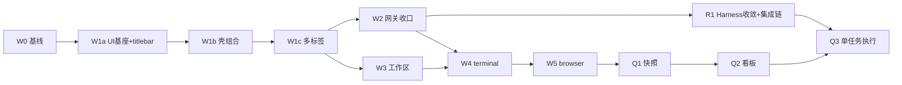

# 迁移与产品化计划（唯一执行源）

> 状态：待执行。本文档集只完成分析与计划，不代表任何迁移任务已经完成。
>
> 版本：v2.1（合并版，目录由 plan2 更名为 plan）· 2026-10-28。本目录由三方合并而成：原 plan2 全文为基座；吸收 plan1 的模块量化基线、harness 单测前置与 canvas 状态板机制；采纳 [`archive/plan1/reviews/2026-10-28-plan-review.md`](../archive/plan1/reviews/2026-10-28-plan-review.md) 的全部修改（W1 拆分、视觉规范指向、组件来源、字体决策门）。plan1 已归档，不再维护。
>
> 范围：以 `innate-labs` 的 M0–M2 可运行桌面基线为源，以本仓 `innate-desktop` 为唯一前向目标仓，按 W0 → W1a/W1b/W1c →（W2∥W3）→ W4 → W5 → R1 → Q1 → Q2 → Q3 逐段迁移。
>
> 原则：先恢复行为，再调整结构；每个阶段都有真实桌面验收；不 fork orca，不把旧 P 系列平台扩建混入基线迁移。

## 1. 阅读顺序

1. [项目分析](./01-project-analysis.md)：两个仓库的真实现状、差距、冲突和迁移判断。
2. [模块分析](./02-module-analysis.md)：模块职责、依赖、规模基线、重复实现、风险与逐项迁移策略。
3. [迁移总计划](./03-migration-plan.md)：目标结构、阶段依赖、统一门禁、证据和回退规则。
4. 按依赖顺序阅读并执行阶段任务卡；执行进度看 §4 状态板与 [canvas/](./canvas/) 投影看板。
5. [平台缺口评估](./04-platform-gap-review.md)：轻应用多形态、宿主通信协议、Agent Provider 决策（P 系列重启基准）。

## 2. 阶段任务卡

| 顺序 | 阶段 | 目标 | 前置 | 任务卡 |
| --- | --- | --- | --- | --- |
| 0 | W0 | 原样恢复可运行基线，统一目标仓工程门禁，源头修复日志脱敏 | — | [W0 基线迁入](./phases/W0-baseline.md) |
| 1a | W1a | UI 基座接入（Tailwind + `@innate/ui` token + ThemeProvider），只换窗口 titlebar，状态槽留空 | W0 | [W1a 壳第一段](./phases/W1-shell.md) |
| 1b | W1b | `@innate/ui` Sidebar / ContentArea、拆 App.tsx；不改 Surface 语义 | W1a | [W1b 壳第二段](./phases/W1-shell.md) |
| 1c | W1c | 中栏多 Surface 标签（detach 不销毁）+ 降级 + overlay 回归 | W1b | [W1c 壳第三段](./phases/W1-shell.md) |
| 2 | W2 | magpie 生命周期/控制台/接线/状态收口（网关侧） | W1c | [W2 运行时与模型网关](./phases/W2-runtime.md) |
| 3 | W3 | 只读工作区成为右栏 Panel，文档进入中栏 | W1c | [W3 工作区](./phases/W3-workspace.md) |
| 4 | W4 | 主进程 PTY terminal，共享工作区 cwd | W2、W3 | [W4 Terminal](./phases/W4-terminal.md) |
| 5 | W5 | 独立 browser Surface 与安全导航、下载 | W4 | [W5 Browser](./phases/W5-browser.md) |
| r | R1 | 两套 Harness 收敛 + DSH 真实集成链（boot→wire→chat） | W2 | [R1 Harness 收敛](./phases/R1-harness.md) |
| 6 | Q1 | 一句话生成经审计的本地项目快照 | W5 | [Q1 计划生成](./phases/Q1-plan.md) |
| 7 | Q2 | project-canvas 成为给人看的项目中栏 Surface | Q1 | [Q2 项目看板](./phases/Q2-canvas.md) |
| 8 | Q3 | 一次执行一条任务，按 capability 路由并回写证据 | Q2、R1 | [Q3 单任务执行](./phases/Q3-task.md) |

W2 与 W3 在 W1c 完成后可以并行；合流后才能进入 W4。R1 只依赖 W2，可与 Q1/Q2 并行推进（不动工作台 UI），但 Q3 开工前必须全绿。其余阶段不跨越未通过的前置门禁。

## 3. 本计划解决的问题

- 源仓已有完整 Electron 桌面实现；目标仓的旧 `@susu/web` 验证应用已废弃删除，当前按本计划重新实现桌面，不把“文档里的目标架构”当成已存在代码。
- 目标仓根工程已统一为 `innate-desktop`，后续保持工程名、脚本和新产品描述一致。
- 源仓桌面私有 Harness 与壳无关 Harness 服务并存，必须经真实行为对照后收敛（R1），不能直接指定其中一套然后删除另一套。
- 当前 UI 必须消费外部 `@innate/ui`，不能在目标仓复制 primitive 或重新维护一套 token；**视觉规范以 `.agents/skills/susu-overview/STYLEGUIDE.md`（orca 副本）+ 技能替换表为执行标准**，`docs/original/innate-dogic/architecture/style-guide.md` 是过时草案不执行，`styleguide/native-chat.md` 不执行（对话 UI 是 DSH）。
- 旧文档同时存在 P 系列平台计划与 W/Q 迁移计划。本目录只负责 W/Q 迁移；P3–P5、方向 B、MCP Apps、轻应用市场等保留为后续 backlog（见 `docs/original/`）。
- project-canvas 的 JSON 快照、派生状态与 HTML 展示必须分离；HTML 永不成为任务事实源。

## 4. 状态板

阶段完成时在此回写状态与证据链接；机读投影在 [canvas/](./canvas/docs/sprints/README.md)（改任务卡后按 canvas 纪律 audit → sync → board，不手改 `out/`）。

| 阶段 | 状态 | 证据 |
| --- | --- | --- |
| W0 | **done（2026-10-28）**：8 卡全部完成——源头脱敏/工程身份/整树迁入/工具适配+引擎修复/行为对照 12 项一致/便携真机冒烟/执行源切换。Sprint 记录 docs/sprints/w0/ | [evidence/W0/](./evidence/W0/) |
| W1a / W1b / W1c | W1a **done（2026-10-28）**：行为基线、产品主题与三区 titlebar 全绿；W1b **done（2026-10-28）**：注册表元数据+@innate/ui 壳组合+右栏挂载点+回归全绿。最终全仓 build/typecheck 通过，21 个测试文件 132/132，desktop 22/22，完整真机冒烟通过；W1c 已拆解，可进入开工门禁 | [evidence/W1a/](./evidence/W1a/)、[evidence/W1b/smoke/](./evidence/W1b/smoke/) |
| W2 / W3 | 待执行 | — |
| W4 / W5 | W4 **done（2026-10-29）**：7 卡全部完成——PTY 技术 spike、terminal+process capability 契约（通用 handler registry）、主进程 TerminalService、renderer Terminal Surface、root 变更语义、受控 process:execute、安全便携与故障回收验收；Sprint 记录 docs/sprints/w4/。W5 **进行中（2026-10-30）**：W5.1 **done**——browser 契约与 provider 策略层（协议白名单/独立分区/capability/凭据拒绝）；W5.2 **done**——独立 WebContents 生命周期（多标签/切换不重载/关闭回收/崩溃隔离/挂 W1c registry + electron spike 12/12）；W5.3 **done**——导航与外链规则（地址栏面板、will-frame-navigate/will-redirect 逐跳守卫、重定向最终地址优先、错误页净化、window.open 交系统浏览器 + electron spike 20/20）；W5.4 **done**——默认拒绝敏感权限（权限策略纯模块 + 分区 session 全拒 handler + origin/类型脱敏记录 + 面板可诊断文案 + electron spike 23/23）；W5.5 **done**——受控下载（下载策略纯模块 + will-download 系统保存对话框确认路径 + 脱敏下载事件 + 关闭取消在途下载 + electron spike 34/34）；W5.6 **done**——安全浏览布局状态（布局策略纯模块 + 敏感 URL 拒绝入快照 + 版本不兼容安全回退 + 挂载消费恢复用户可见重导航，browser 76/76、desktop 100/100）；W5.7 待执行。Sprint 记录 docs/sprints/w5/ | [evidence/W4/](./evidence/W4/)、[evidence/W5/](./evidence/W5/) |
| R1 | 待执行 | — |
| Q1 / Q2 / Q3 | 待执行 | — |

## 5. 统一任务规则

每张任务卡中的任务均使用以下字段：

- **改动位置**：允许修改的主要文件或模块；不是禁止阅读其他文件。
- **实施**：可执行的步骤，不以“完善”“优化”等无法验收的词作为交付。
- **验证**：自动测试、真实 Electron 冒烟或隔离环境集成验证。
- **完成标准**：任务可标记 done 的必要条件。
- **回退**：本阶段失败时回到哪一个可运行点。

统一要求：

1. 产品、工具与测试代码保持 strict TypeScript。
2. 真实 magpie 只跑只读命令；wire/default/unwire 使用 mock 或隔离临时 `DSH_HOME`。
3. 认证 URL、token、key 不进入日志、快照、测试夹具或证据截图。
4. 新 UI primitive 只从 `@innate/ui` 单入口导入；颜色、间距、字号使用语义 token；明暗使用 `.dark` class。组件来源三分法见 [01 §5](./01-project-analysis.md)。
5. 每个阶段结束保存命令结果、测试数、截图和已知限制到 `docs/susu/plan/evidence/<PHASE>/`。
6. 一个阶段未全绿，不开始依赖它的下一阶段；修复不得通过删除旧测试或降低安全断言完成。
7. **并发会话协作协议**（2026-10-28 双会话实测后固化）：
   - **按 task 领取即加锁**：开工先 `task.py status <id> in_progress`，这是唯一的锁信号；会话开工前先 `overview`/`list` 查看在途任务，不碰他人 in_progress 的任务。
   - **文件所有权随任务走**：任务的「涉及模块」就是它的锁范围；只有两个任务的模块集合不相交才可并行（W2∥W3 的设计即此）；相交时后到者等前者 done。
   - **一 task 一提交**：任务 done 即 commit（信息带任务编号），冲突面收敛到单任务；共享热点文件（tools/smoke-desktop.ts、docs/README、投影）原则上单属主，或「只追加不改他人段落」。
   - **等门禁不等人**：一方跑 build/smoke 等 IO 时，另一方可以推进不相交任务——这是双会话的主要收益场景。
   - 拿不准时默认串行：用户对单一会话说「下一个 task」。

## 6. 非本轮范围

- fork orca 或复制其 per-agent 账号、模型、用量体系。
- 新建空 `innate-backend`、通用动态插件加载器或万能 Cordis 兼容层。
- 文件写入、Git stage/commit、并行多 Agent、GitHub 作为内部任务数据库。
- DSH 作为唯一执行内核，或在 DSH 内递归嵌入完整 Innate 桌面。
- 轻应用市场、Kimi Widget 钉卡、MCP Apps 全量兼容、NSIS 大包装、手机隧道和自动更新。

## 7. 与被合并材料的关系

| 来源 | 处置 |
| --- | --- |
| plan1 正文（2026-10-28 上午） | 归档至 `docs/susu/archive/plan1/`；其模块量化表并入本计划 02，harness 单测前置并入 W0/R1，canvas 状态板机制由本目录 canvas/ 承接 |
| plan1 review（2026-10-28） | 全部采纳：W1 拆 a/b/c、视觉规范指向技能副本、组件来源三分法、字体决策门（W1a.0）、native-chat 不执行、docs/README 执行源修正 |
| `.project-canvas/`（并发会话预览产物） | 归档至 `docs/susu/archive/project-canvas-preview/`，非事实源；机读投影以本目录 canvas/ 为准 |
